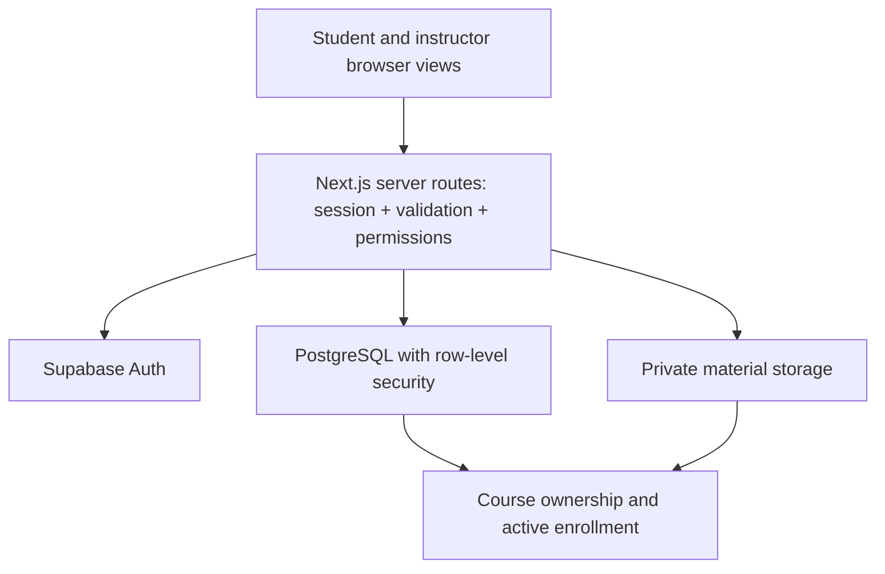

# Proposed architecture and shared contracts

This is a design for the new team application, not a description of features already implemented. Agree it at kickoff, then change contracts through short, reviewed decisions. Use [PLAN.md](PLAN.md) for scope and ownership.

## Keep the implementation small

Use a single Next.js/TypeScript application with a React UI, server route handlers, Supabase Auth, PostgreSQL, and private file storage. Tailwind and a small shared UI component set are enough. Use migrations and generate database types for the new schema. Select package versions during setup; the old project's manifest is a reference rather than a dependency set to copy blindly.

No microservices, background workers, separate custom auth system, AI provider, or email transport is needed for the required product. Design for a class demonstration with a few courses and dozens of test users. Revisit pagination, indexing, file processing, and infrastructure if usage grows; load testing a campus-scale LMS is outside this project.

The diagram shows logical authorization dependencies. Storage policies resolve the related course/material and membership in PostgreSQL. A hidden button is not authorization. Normal application operations use the signed-in user's database client so row-level security (RLS) applies. Provisioning instructor capability is a separate trusted setup operation; never send a service-role key to the browser.

## Accounts and permissions

Provision at least two instructor accounts, two students, and an outsider for testing. Public signup and an account-management UI are optional. Store instructor capability in a separate protected table that users cannot modify, instead of a self-editable profile field. Do not trust signup metadata or a request body's `role`, `student_id`, or `instructor_id`.

- An instructor can create courses and administer only courses they own.
- A student with active enrollment can read published course content and manage their own progress/submission.
- A person can be an instructor in one course and a student in another. Course ownership and membership determine authorization for the particular course; no global instructor permission grants access to all courses.
- The course owner cannot also enroll as a student in that same course in the MVP.
- Only the owner sees the full roster. Students get their own enrollment, not other students' profiles.
- After leaving a course, the student loses content and result access. Keep their submission/feedback records for the instructor. Rejoining restores access to the same records, without duplicates.

| Action | Owning instructor | Enrolled student | Outsider / different instructor |
| --- | --- | --- | --- |
| Read active course and published content | Yes | Yes | No |
| Read draft material/assignment | Yes | No | No |
| Edit course, publish content, see roster | Yes | No | No |
| Read a submission and its returned feedback | All in own course | Own only | No |
| Create submission | No | Own; published assignment; active course; before deadline | No |
| Change submission body after acceptance | No | No in MVP | No |
| Return score/feedback | Yes, for own course | No | No |
| Read/change student progress | No in MVP | Own only | No |

Archived courses disappear from active lists and reject new enrollments, uploads, publishing, progress writes, and submissions. Existing participants retain read access; instructor review of already submitted work remains allowed. No hard course deletion, instructor account deletion, or ownership transfer UI in the MVP. If the rubric requires deletion, design its shared-record/file behavior explicitly rather than copying personal-data purge logic.

## Minimum data model

Names are proposed contracts. Use UUID primary keys and timestamp columns as appropriate. Add indexes to foreign keys used in course/member lists; use uniqueness constraints rather than relying on UI checks.

| Table | Important fields and constraints | Owner |
| --- | --- | --- |
| `profiles` | `id` → auth user, `display_name`, `timezone`; own profile edits only. Email remains in auth and is not exposed to classmates. | Ahmed |
| `instructor_accounts` | `user_id` unique → profile; trusted setup writes only. | Ahmed |
| `courses` | `id`, `instructor_id`, `title`, `description`, `archived_at`; creator must have instructor capability; owner immutable to ordinary edits. | Muhammad |
| `course_invites` | `course_id` unique, unique `code_hash`, `enabled`; server enrollment function/owner management only, never readable by enrolled students. | Ahmed |
| `enrollments` | `course_id`, `student_id`, `joined_at`, `left_at`; unique `(course_id, student_id)`; active when `left_at IS NULL`. | Ahmed |
| `materials` | `id`, `course_id`, `title`, `storage_path`, `original_filename`, `mime_type`, `size_bytes`, `published_at`; storage path unique and bound to this material/course. | Muhammad |
| `assignments` | `id`, `course_id`, `title`, `instructions`, `due_at`, `max_score > 0`, `published_at`; author authority comes from course ownership. | Salman |
| `assignment_progress` | `assignment_id`, `student_id`, `state` = `not_started` or `in_progress`; unique pair. Submitted/returned/overdue are derived, not freely writable states. | Salman |
| `submissions` | `id`, `assignment_id`, `student_id`, `body`, `submitted_at`; unique `(assignment_id, student_id)`; body/student/assignment/time immutable after accepted insert. | Salman |
| `submission_feedback` | `submission_id` unique, `reviewer_id`, `score`, `feedback`, `returned_at`; owning instructor writes, associated student reads. | Aya |

One assignment is shared by all enrolled students. Student A submitting must never update a shared assignment's status or stop Student B's work. No student-specific priority, completion, score, or reminders belong on `assignments`.

Published assignments allow correction to title/instructions and extension of the deadline; no shortening the due time, unpublishing, changing `max_score`, or deleting after publication in the MVP. This keeps accepted submissions and scores consistent without adding version history. Drafts may be freely edited. Feedback can be corrected by the same course owner, with an updated return timestamp; feedback audit history is a later extension.

## Critical write rules

RLS must cover SELECT, INSERT, UPDATE, and DELETE separately as needed. Validate the new row as well as the existing row for updates; do not permit changing a foreign key to a different course/student to bypass permissions. Keep helper-policy lookups free of recursive enrollment/course policy cycles. If a narrow database function needs elevated privileges, fix its search path, validate the authenticated caller, and limit execute grants.

1. **Create a course:** derive `instructor_id` from the verified session. Atomically create its invite record or offer a recoverable invite-generation action. Client-supplied ownership is rejected.
2. **Join:** resolve the submitted code on the server without exposing a course catalog or invite table. Use a random code, store a hash, rate-limit attempts, and return a generic failure for invalid/unavailable codes. Atomically create/reactivate only the caller's enrollment; joining twice succeeds without a duplicate. Enrollment rows cannot be inserted directly to bypass code validation.
3. **Leave:** soft-close only the caller's enrollment; do not delete assignments, submissions, or other people's membership. The instructor sees historical submission authors even if no longer enrolled, through a narrowly scoped roster/submission query.
4. **Submit:** in one database-enforced operation check published assignment, active course, active enrollment, caller identity, and database time `now() <= due_at`; insert once. Handle concurrent duplicates via the unique constraint. A retried request must show the existing receipt or a clear duplicate response, not create a second submission.
5. **Return feedback:** verify submission → assignment → course ownership, derive reviewer from session, enforce `0 <= score <= max_score`, and write result atomically. A database function/trigger must enforce the cross-table score bound; a UI-only bound is insufficient.
6. **Progress:** a student may write only their own allowed progress row for an accessible published assignment. Submission and returned states come from actual submission/feedback records.

Agree and document these rules before owners build different interpretations. Test direct database operations as well as HTTP routes so route validation is not the sole protection.

## File sharing

For the MVP, instructor uploads are PDF-only, at most 10 MB, and published through an explicit action. Validate size and basic PDF content server-side; extension and browser MIME alone are insufficient. Do not parse or run uploaded content.

- Store files privately at an application-generated path such as `courses/{course_id}/materials/{material_id}/{random_id}.pdf`. Never trust a client-provided storage path as proof of ownership.
- Only that course's instructor can upload/delete. Read policies require instructor ownership or active enrollment plus a published material record. Course membership must not expose drafts.
- Authorize each material request, then create a short-lived signed download URL, for example five minutes. Keep invite codes out of material/profile responses. An already issued signed URL can remain usable until expiry after leaving a course; document this limit.
- Handle failed metadata creation/upload with compensating cleanup or a retryable unpublished record. Handle failed deletion without claiming the file is gone. Deleting a material removes its access record and attempts file cleanup; return a visible retryable error for cleanup failure.
- Test bucket/object access with normal authenticated users, including guessed object paths. A private bucket alone does not establish membership authorization.

## Proposed HTTP contracts

Prefix the following with `/api`. Return JSON in camelCase; map database snake_case in the server. Use `{ error: { code, message } }` for errors. Use `401` for missing session, `403` for a forbidden action on an otherwise visible resource, and `404` for unavailable/inaccessible course content. Validation failures are `400`; duplicate/conflicting or closed-state writes are `409`. Cap list sizes; add pagination if needed by fixtures or the rubric.

| Method and path | Purpose / response | Owner |
| --- | --- | --- |
| `GET /me` | Own profile and instructor capability. | Ahmed |
| `POST /courses/join` | `{ code }` → `{ enrollment: { courseId, studentId, joinedAt } }`. | Ahmed |
| `DELETE /courses/:id/enrollment` | Soft-leave own enrollment; idempotent. | Ahmed |
| `POST /courses/:id/invite` | Owner generates/rotates invite; raw code returned only in this response. | Ahmed |
| `GET, POST /courses` | Accessible course list / create course. List includes membership kind, never invite secrets. | Muhammad |
| `GET, PATCH /courses/:id` | Accessible details / owner changes metadata or archives. | Muhammad |
| `GET /courses/:id/students` | Owner's minimal roster, including identity needed to review historical submissions. | Muhammad |
| `GET, POST /courses/:id/materials` | Accessible material list / owner's upload. | Muhammad |
| `PATCH, DELETE /materials/:id` | Owner publishes or removes material. | Muhammad |
| `GET /materials/:id/download` | Authorized `{ url, expiresIn }`. | Muhammad |
| `GET, POST /courses/:id/assignments` | Accessible list / owner creates draft. | Salman |
| `GET, PATCH /assignments/:id` | Accessible detail / owner edits or publishes. | Salman |
| `PATCH /assignments/:id/progress` | Own `not_started` / `in_progress` choice. | Salman |
| `POST /assignments/:id/submissions` | `{ body }` → `{ submission: { id, assignmentId, submittedAt } }`. Caller supplies no student ID. | Salman |
| `GET /assignments/:id/submissions` | Owner gets assignment submissions; student gets only their own, including returned feedback. | Salman |
| `PUT /submissions/:id/feedback` | `{ score, feedback }` → returned feedback; owner only. | Aya |
| `GET /dashboard` | Student's enrolled courses and assignment summaries with derived own status/feedback. | Aya |

Course lists/details include `id`, `title`, `description`, `archivedAt`, and `membershipKind` (`instructor` or `student`). Assignment lists/details include `id`, `courseId`, `title`, `instructions`, `dueAt`, `maxScore`, `publishedAt`; student responses additionally include `myProgress`, `mySubmission`, and `myFeedback`. An instructor never gets those fields as another student's editable progress. Roster entries expose only necessary IDs/display names and membership status.

Aya's review screen consumes Salman's submissions endpoint. Salman's student detail consumes Aya's feedback result. Agree these fixtures in week one, connect real responses in week three, and include both owners on changes to those contracts.

## Dates and derived state

Store times as timezone-aware timestamps. Instructor chooses a local due date/time with an explicit timezone; convert once, store the instant, and show students the time in their own timezone. Database time decides submission acceptance. Past the deadline, display “overdue” only if no accepted submission exists. “Returned” means a feedback record exists. “Submitted” means a submission exists without returned feedback. Do not let an AI score or a manual progress toggle set these states.

## Required integration checks

Use a fresh test database with instructor I, instructor J, students A/B, and outsider O. Never run destructive test fixtures against the original StudyBuddy deployment.

- I creates course; J cannot edit it or list its submissions. A/B join; O cannot guess their way into content access.
- Duplicate join is harmless; students cannot assign themselves instructor capability or create enrollment for another person.
- A reads a published PDF/assignment but not drafts; unauthorized object download fails.
- A submits once before deadline; B remains unsubmitted; O cannot submit; duplicate concurrent attempts produce one row.
- Client-supplied student IDs/timestamps cannot impersonate another student or bypass the deadline. Late submission fails even through direct database access.
- I returns A's valid score; B/O cannot read it; A cannot write a score; J cannot grade; an excessive score fails at the database boundary.
- A leaves; new content access fails; instructor still sees A's historical submission. Rejoin restores records without duplication.
- Archived course blocks new activity while existing participants can read and instructor can return existing work.
- Two students viewing the dashboard get independent progress/results; invalidation/refetch after submission/feedback shows fresh state.
- PDF upload failure, missing file, invalid input, and expired download URL produce usable error/retry behavior.

Feature owners implement their checks; reviewers run the relevant cross-account scenario. Ahmed coordinates coverage rather than writing every test.
