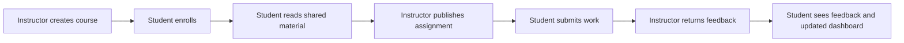

# StudyBuddy-inspired team project

Team: Ahmed, Muhammad, Salman, and Aya. Planning date: October 22, 2026.

Build a new course and study platform together over approximately six weeks. Use StudyBuddy to discuss useful behavior, but write the application, database migrations, tests, and UI yourselves in a new team repository. 

## The product to finish

An instructor creates a course, gives students an enrollment code, shares materials, publishes assignments, reviews submissions, and returns a score and written feedback. Students join courses, access the same published materials and assignments, see upcoming deadlines, submit work, and read their own feedback.

The final demonstration must use different accounts in separate browser sessions. A teacher dashboard with mock data is not the finished feature.

## What this repository tells us

Inspected reference revision: `fe207b5`. This is a source inspection, not a runtime audit.

| Existing reference | Observed behavior | Team project decision |
| --- | --- | --- |
| [Courses API](../../src/app/api/courses/route.ts), [queries](../../src/lib/supabase/queries.ts) | Course lists filter by the current user's `user_id`; these are personal course records. | Build shared instructor-owned courses with student enrollment. |
| [Assignments API](../../src/app/api/assignments/route.ts) | The current user owns the assignment and its progress/status. | Keep one instructor assignment; store each student's progress separately. |
| [Materials upload](../../src/app/api/materials/upload/route.ts), [storage policies](../../supabase/migrations/008_storage_buckets.sql) | Uploads belong to a user's course; storage access checks the user's folder. | Instructor uploads once; enrolled students get authorized access to the shared file. |
| [Submissions API](../../src/app/api/submissions/route.ts) | Work is submitted against the user's own assignment and receives automated validation. | Submit to an instructor's assignment; human instructor feedback determines the course score. |
| [Initial schema](../../supabase/migrations/001_initial_schema.sql), [types](../../src/types/database.ts) | Personal data model; no course enrollment or instructor permission model in the inspected schema/types. | Design a new, smaller schema around course membership. |
| [Signup page](../../src/app/(auth)/signup/page.tsx), [admin check](../../src/lib/admin.ts) | Signup UI is closed; administrators are identified by an email allowlist. | Use deliberately provisioned demo accounts first; application administrators and instructors are different concepts. |
| [README](../../README.md), [package manifest](../../package.json) | Next.js, TypeScript, React, Tailwind, Supabase, AI providers, calendar, reminders, and tests. | The same general stack is reasonable; independently implement a smaller product. |

These paths are reading references, not a list of files to copy. Existing AI, reminder, account-deletion, and storage logic assumes personal ownership; importing it would also import assumptions that do not fit shared courses.

## Scope: commit to this first

| Required for the six-week product | Acceptance boundary |
| --- | --- |
| Authentication and permissions | Provisioned instructor/student accounts; login/logout; server and database authorization. Public registration is optional. |
| Courses and enrollment | Instructor creates/edits/archives own course; student joins by code; instructor sees its roster. |
| Shared materials | Instructor uploads a PDF, publishes it, and enrolled students can open/download it. Private bucket; 10 MB maximum as a proposed project limit. |
| Assignments | Instructor creates a draft with title, instructions, due time, and maximum score, then publishes it. Students cannot see drafts. |
| Student submissions | One text submission per student per published assignment; receipt and submission time; no AI dependency. |
| Instructor review | Course instructor views submissions and returns a numeric score plus feedback; each student sees only their own result. |
| Student overview | Enrolled course list, upcoming assignment agenda, and independent assignment progress. An agenda satisfies the deadline view; a calendar grid is optional. |
| Delivery evidence | Fresh setup works, shared staging demo, meaningful permission tests, contribution record, and class deliverables. |

Choose at most one enhancement after the complete required flow passes in staging: file attachments for submissions, course announcements, or a calendar grid. Only consider AI summaries/chat after those are stable and if the rubric values AI. Course search, public catalogs, chat/forums, attendance, quizzes, group submissions, multiple instructors, email/push delivery, and LMS integrations are outside the committed scope.

Rebuilding every existing StudyBuddy feature plus an instructor platform is too much to promise before assessing the team. The instructor/student workflow is already a substantial new product direction.

## Named ownership

Every owner delivers UI, API/data behavior, validation, relevant tests, and documentation for their feature. Reviewers help; they do not become the hidden implementer.

| Person | Primary workstream | Concrete finished result | Regular reviewer |
| --- | --- | --- | --- |
| **Ahmed** | Team coordination, authentication, enrollment, shared permission helpers | Users can sign in; instructor capability is provisioned securely; students can join/leave; server and database can distinguish owner, member, and outsider. | Aya |
| **Muhammad** | Instructor courses and shared materials | Instructor creates/edits/archives a course, views roster, uploads/publishes PDFs; enrolled students can read/download them. | Ahmed |
| **Salman** | Assignment publishing and student submission | Instructor drafts/publishes assignments; student submits text and sees a reliable receipt; records enforce one submission per student/assignment. | Muhammad |
| **Aya** | Student overview and instructor review | Student sees courses/deadlines/progress; instructor sees submissions and returns score/feedback; the correct student sees the result. | Salman |

Shared foundations are agreed together on day one. Each feature owner writes their own migrations and access policies, reviewed by another person. Ahmed is not the only person allowed to touch the database or merge code. Rotate meeting notes, demo hosting, and release checks weekly.

Plan around **six hours per person per week**, pending availability: about 144 team hours over six weeks. For Ahmed, reserve about two of those weekly hours for coordination/review and four for implementation. For the others, reserve about one hour for coordination/review and five for implementation. Aim to spend roughly 75% of remaining implementation time on planned work and keep 25% for learning, bugs, and integration. Reduce scope if this capacity is unavailable; do not fund the gap with Ahmed's unplanned labor.

## Six-week delivery plan

Use actual dates after confirming the semester deadline. Six weeks from the planning date is only an estimate, not a confirmed due date.

| Week | Ahmed | Muhammad | Salman | Aya | Team exit condition |
| --- | --- | --- | --- | --- | --- |
| **1: agree and start** | Bootstrap auth/session and provision test identities; lead contract discussion. | Course schema/form/list skeleton. | Assignment schema/form with synthetic data. | Shared navigation, student overview skeleton, review-screen wireframe. | All four run the new repo, open a small PR, review another PR, and explain their slice. Agree schema, permissions, rubric, and scope. |
| **2: connect real accounts** | Join/leave implementation and permission helpers. | Real course create/edit/archive and roster; start material upload. | Draft/publish/read assignments using real courses. | Student course/deadline queries; review UI against agreed response fixtures. | Real instructor creates course; two students join; published assignment visible to both; outsider denied. |
| **3: finish the loop** | Enrollment edge cases and cross-account tests; support integration. | Publish/read/download materials with storage policies. | One-time text submission and receipt; student progress endpoint. | Submission inbox and score/feedback return. | Full create → enroll → material → assignment → submit → feedback flow runs in staging. |
| **4: harden and evaluate** | Audit permissions with a partner; fix own slice. | Storage failures, roster privacy, archive behavior. | Deadline/duplicate-submit tests and safe assignment edits. | Student result/progress isolation; usable loading/error states. | Required flow and denial tests pass; everyone has demonstrated their own feature. Add one optional feature only if this gate passes. |
| **5: freeze scope** | Coordinate regression review and class-document checklist. | Fix defects; write course/material setup notes. | Fix defects; document assignment/submission behavior. | Fix defects; polish overview/review and demo flow. | Feature freeze; fresh setup verified by someone other than its author; draft report/slides and contribution evidence complete. |
| **6: rehearse and submit** | Own auth/enrollment presentation and final checklist. | Own course/material presentation and release check. | Own assignment/submission presentation and regression run. | Own overview/review presentation and demo fixture reset. | Stable release, rehearsed demo, backup recording, report, and required submission files. No new features. |

Dependency order: shared contracts → course plus auth → enrollment plus published assignment → submission → feedback. Materials proceed alongside assignments. Aya can build against agreed fixtures while Salman implements submission endpoints; fixtures do not count as the integration milestone.

## What counts as done

- An issue states observable acceptance criteria and has one owner and one reviewer.
- UI uses real stored data, validates inputs, and handles loading, empty, and error states.
- Permission-sensitive behavior is tested with distinct instructor, student A, student B, and outsider accounts. Other instructors cannot administer this instructor's course.
- Feature tests check behavior, not just rendered labels. Database/storage access is checked using normal authenticated clients, not only an administrator client.
- The new project's type check, lint, automated tests, and production build pass; set these scripts up in the new repo. Reference-repository tests do not validate the new application.
- A teammate reviews the PR, the owner demonstrates the feature, and it works in staging.
- Documentation and contribution notes name what was built, reviewed, paired on, and reused from any source.

## Leadership agreement

Run a 30-minute kickoff, a 10-minute midweek blocker check, and a 20-minute weekly working demo. Use one issue board: Backlog → Ready → In progress → Review → Done. Keep one implementation issue in progress per person and review within one working day.

Ask for an update twice a week: “What can we run now? What is next? What is blocking you?” If someone is stuck for a day, pair for 20–30 minutes and shrink the task. If a commitment slips repeatedly, record the facts, revise ownership/scope openly, and use the class's team-contribution process early. Do not quietly complete somebody else's entire feature.

Your job is to make responsibilities, decisions, and integration visible. You do not need to convince the group that everyone is motivated before starting; the first small deliveries will give you better evidence.

## Start here

1. Share this proposal and hold the kickoff; confirm deadline, rubric, hours, experience, and assignments.
2. Create a new team repository and a separate development/staging Supabase project. Do not change this existing application's database for the class build.
3. Complete the first four individual tasks in [BACKLOG.md](BACKLOG.md) within the first two days; adjust ownership based on that evidence.
4. Agree [ARCHITECTURE.md](ARCHITECTURE.md) before independently changing shared schema/contracts.
5. Use [LEADERSHIP.md](LEADERSHIP.md) for the meeting agenda, team message, PR checklist, and handling missed work.

Tell the instructor that an existing personal project inspired the concept and that the team intends to implement a new application. Confirm whether the course has additional rules about prior project concepts or AI use. Record StudyBuddy as a concept reference; do not imply that changing repository history establishes independent authorship.
